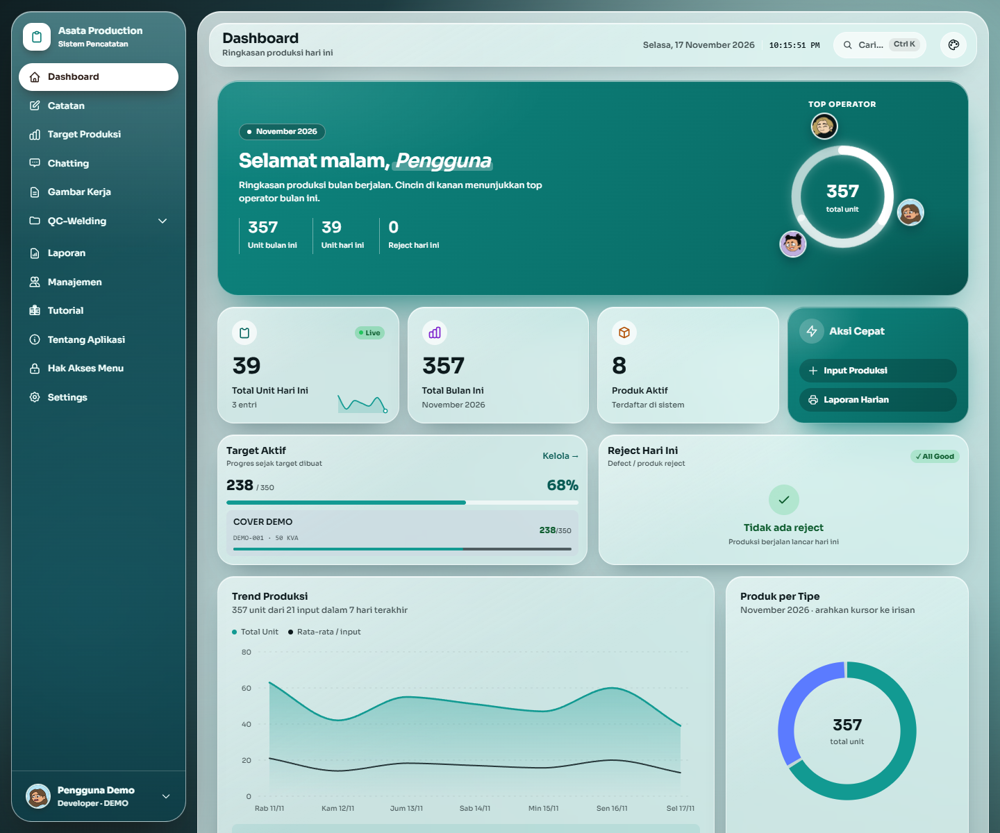
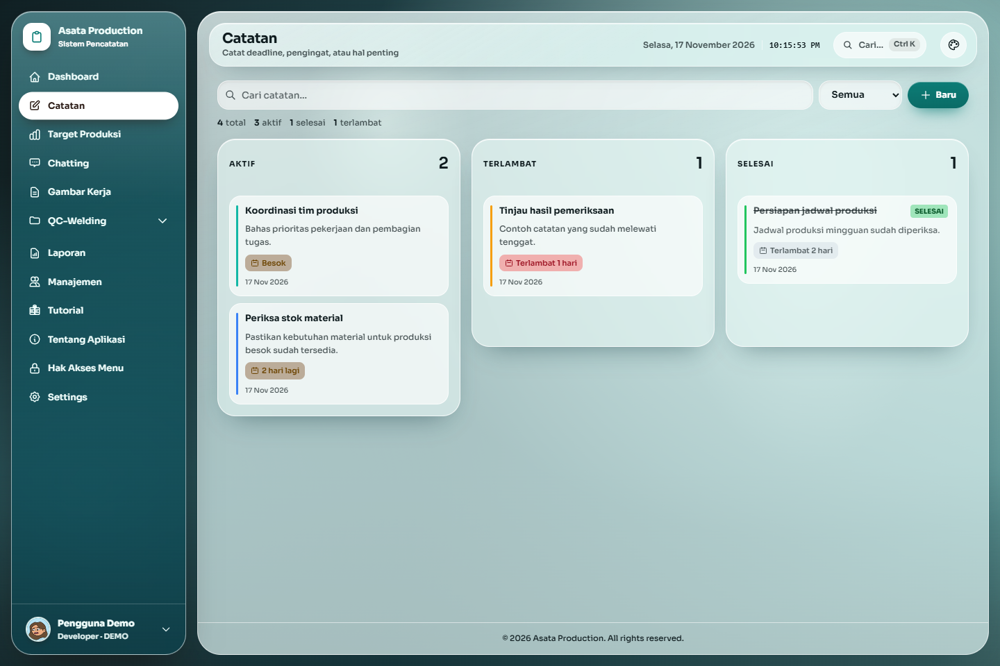
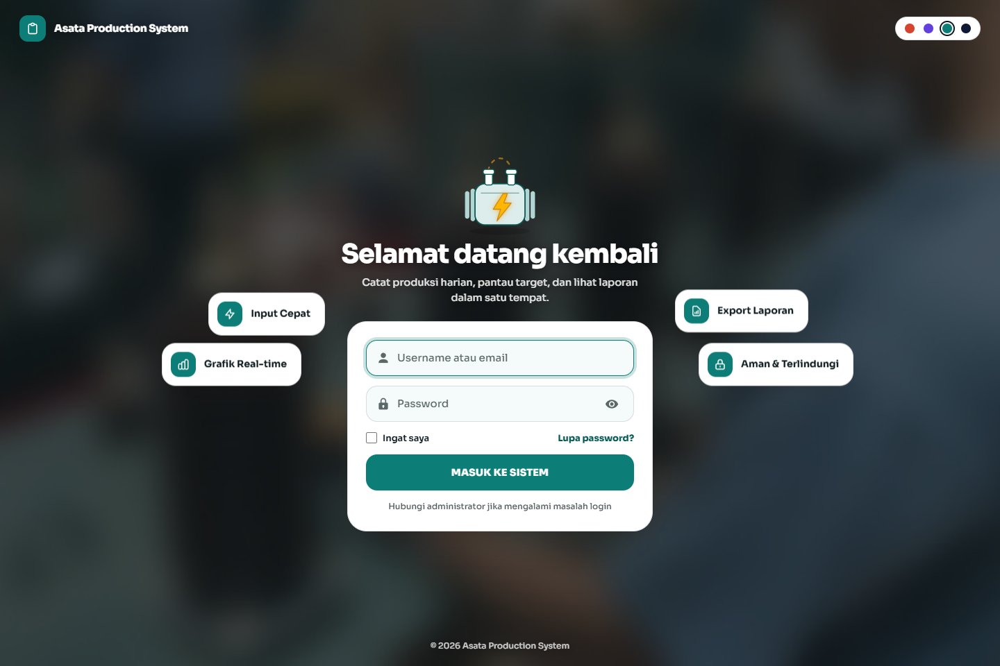
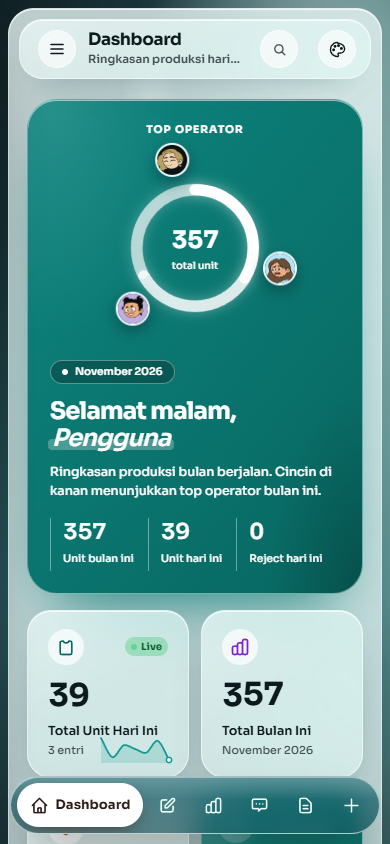

# Asata Production System

Sistem pencatatan produksi dan quality control untuk pabrik trafo. Operator mencatat hasil produksi harian (UP/BT untuk channel, jumlah unit untuk cover/tangki), sementara admin, supervisor, dan mandor memantau target, laporan, dan riwayat.

Tersedia dalam tiga bentuk yang memakai data & hak akses yang sama:

- **Web**: Laravel + Inertia/React (repo ini).
- **Aplikasi Android**: aplikasi native (Kotlin + Jetpack Compose), bukan WebView.
- **Aplikasi Windows**: aplikasi native (Kotlin + Compose Multiplatform Desktop), dipasang lewat installer MSI.

Ditambah bot Telegram untuk lapor produksi dan cek jadwal dari HP.

[](LICENSE)

---

## Tampilan aplikasi

Screenshot berikut memakai database demo terpisah. Nama operator, seri produk, angka produksi, dan catatan adalah contoh, bukan data pabrik atau konfigurasi server.

### Dashboard



### Papan Catatan



<details>
<summary>Lihat halaman login dan tampilan HP</summary>





</details>

---

## Fitur Utama

| Menu | Isi |
|---|---|
| **Tampilan kaca** | Empat tema: Coral, Violet, Ocean, dan Gelap; mode ringan, palet Ctrl+K, sidebar ringkas, serta dock navigasi HP |
| **Dashboard** | Ringkasan hari ini & bulan ini, kalender (hari libur nasional & fase bulan), tren produksi, target aktif, reject, catatan & input terbaru, log aktivitas |
| **Catatan** | Papan Aktif, Terlambat, dan Selesai; editor teks, foto/kamera, tenggat, dan penerima |
| **Target Produksi** | Foto jadwal gambar/PDF, target jumlah atau nomor urut, deret UP/BT terpisah untuk channel, serta progres yang diperbarui otomatis |
| **Chatting** | Pesan antar pengguna (termasuk sesama developer/admin), status mengetik & dibaca |
| **Gambar Kerja** | Upload banyak file (JPG/PNG/PDF) per judul-seri-kVA, pratinjau PDF, cache offline, **keterangan per file** (mis. "Revisi ke-2") |
| **Input & Riwayat Produksi** | Input per produk dengan nomor urut UP/BT, seri & kVA manual, reject unit; riwayat per tanggal & kategori, input cepat lewat modal |
| **Barang Pengganti & Aksesoris Keluar** | Pencatatan barang pengganti dan aksesoris keluar beserta ekspor; **kategori aksesoris** bisa difilter, diubah nama (otomatis digabung bila sama), dan dihapus bila tidak dipakai |
| **Master Produk & Kategori** | Produk dikelompokkan per tahun dan nama, urutan & warna kartu bisa diatur, kategori dengan opsi *seri manual* |
| **Laporan** | Rekap harian & bulanan, ekspor PDF dan Excel |
| **Manajemen & Hak Akses** | Kelola pengguna per departemen; hak akses menu & aksi per peran (tampilan matriks) bisa diubah tanpa ubah kode |
| **Profil** | 80 pilihan avatar kartun atau foto sendiri, ganti password, logout perangkat lain, tautkan Telegram |
| **Tutorial** | Panduan bergambar tiap menu dengan penanda bernomor & garis penunjuk |
| **Bot Telegram** | Lapor produksi, cek jadwal, dan notifikasi lewat Telegram (akun ditautkan dari halaman Profil) |
| **Sinkron Gambar dari qc** | Khusus Developer di Settings web, Windows, dan Android. Server memeriksa sumber tiap menit, menambah gambar kerja/foto jadwal baru, serta menampilkan hasil dan konflik tanpa menimpa data yang sudah ada |
| **Pembaruan data** | Pemeriksaan versi ringan dari server, berhenti saat tab tersembunyi, dengan pengambilan data saat ada perubahan dan polling cadangan |
| **Mode Maintenance** | Saklar dari Settings dengan hitung mundur; developer tetap bisa masuk |
| **Panel `/admin`** | Panel Filament untuk dashboard ringkas |

---

## Teknologi

- **Backend**: Laravel 13, PHP 8.4, Filament 5
- **Frontend**: Inertia.js 3 + React 19, Vite 8, CSS kustom (empat tema kaca dan mode ringan)
- **Database**: MySQL 8 / MariaDB 11 (SQLite untuk pengujian)
- **Ekspor**: barryvdh/laravel-dompdf (PDF), maatwebsite/excel (Excel)
- **PDF viewer**: pdf.js (di `public/vendor/pdfjs`)
- **API aplikasi**: REST JSON `/api/v1` dengan Laravel Sanctum (token per perangkat)
- **Aplikasi**: Kotlin 2.1, Jetpack Compose (Android), Compose Multiplatform 1.8 + JDK 21 (Windows)

---

## Aplikasi Android & Windows

Kedua aplikasi native memakai API `/api/v1` (lihat `routes/api.php`): aturan data, hak akses, dan departemen ditangani server yang sama. Perubahan tampilan atau kontrol baru pada aplikasi native tetap membutuhkan pembaruan APK/MSI.

| Platform | Rilis | Unduh |
|---|---|---|
| Android | **1.4.1** (kode 15) | [APK Android](https://asataproduction.yogaariyanto.com/unduh/aplikasi) |
| Windows | **1.1.1** (kode 4) | [Installer MSI](https://asataproduction.yogaariyanto.com/unduh/aplikasi-windows) |

Versi rilis di atas diperiksa pada 17 November 2026. Informasi versi terbaru tersedia melalui `GET /api/v1/aplikasi/versi?platform=android` atau `?platform=windows`.

- Aplikasi mengecek versi saat dibuka dan menawarkan update otomatis bila versi di server lebih baru.
- Gambar kerja & foto yang sudah diunduh disimpan di perangkat sehingga tidak diunduh ulang (penting untuk koneksi pabrik yang lambat).
- Kode sumber aplikasi ada di proyek terpisah (Android Studio). Berkas APK/MSI dan script unggahnya (`android-update/`, `windows-update/`) **tidak** di-commit karena berukuran besar dan memakai kredensial SSH dari `.env`.

Pengunggahan rilis dikelola melalui alat operasional lokal. Skrip unggah, kredensial, keystore, APK, dan MSI tidak disertakan dalam repositori kode maupun payload deploy web.

---

## Peran Pengguna

Hak akses bawaan di bawah bisa diubah per peran lewat menu **Hak Akses Menu** (`config/menus.php` menjadi daftar menu & aksinya).

| Peran | Gambaran akses bawaan |
|---|---|
| **Developer** | Semua menu, termasuk Kategori, Hak Akses, Settings/bot, Tutorial, dan riwayat update |
| **Admin** | Semua menu operasional: master produk, gambar kerja, manajemen pengguna, laporan |
| **Supervisor** | Pantau produksi, target, dan laporan |
| **Mandor** | Pantau produksi, set target, laporan |
| **Operator** | Input & riwayat produksi, barang pengganti, aksesoris, gambar kerja (lihat) |
| **Visitor** | Lihat dashboard dan menu yang diizinkan |

Data produksi dipisah per **departemen**; selain developer, pengguna hanya melihat data departemennya.

---

## Persyaratan Sistem

- PHP >= 8.4 dengan ekstensi `pdo_mysql`, `gd`, `zip`, `mbstring`, `xml`, `fileinfo`, `intl`, `bcmath`, `exif`
- Composer >= 2
- Node.js >= 20 & npm (hanya untuk build aset)
- MySQL >= 8 atau MariaDB >= 10.6
- Apache/LiteSpeed (`mod_rewrite`) atau Nginx

---

## Instalasi Lokal

```bash
# 1. Clone repositori dan masuk ke folder project
git clone https://github.com/yogaariyanto312/asataproduction.git
cd asataproduction

# 2. Dependensi
composer install
npm install

# 3. Environment
copy .env.example .env
php artisan key:generate
```

Sesuaikan `.env`:

```env
APP_NAME="Asata Production"
APP_ENV=local
APP_URL=http://localhost/asata-production/public
APP_LOCALE=id
APP_FALLBACK_LOCALE=en

DB_CONNECTION=mysql
DB_HOST=127.0.0.1
DB_PORT=3306
DB_DATABASE=asata_lokal
DB_USERNAME=root
DB_PASSWORD=

# Inertia DevTools menambah ±250 ms tiap request: nyalakan hanya saat debug
INERTIA_DEVTOOLS_ENABLED=false
```

```bash
# 4. Database (buat dulu database kosong utf8mb4), lalu migrasi
php artisan migrate

# 5. Symlink storage
php artisan storage:link

# 6. Aset frontend
npm run build      # atau: npm run dev (hot reload)
```

**Akun pertama**: seeder bawaan berisi data contoh dan password lemah, jangan dipakai di server. Buat akun developer lewat tinker:

```bash
php artisan tinker
```

```php
App\Models\User::create([
    'name'      => 'Developer',
    'username'  => 'developer',
    'email'     => 'developer@example.com',
    'password'  => bcrypt('ganti-dengan-password-kuat'),
    'role'      => 'developer',
    'is_active' => true,
]);
```

Buka `http://localhost/asata-production/public` lalu login.

---

## Publikasi dan deploy

Repositori ini berisi kode aplikasi, pengujian, aset web hasil build, serta dokumentasi. Alat deploy dan rilis disimpan lokal di luar publikasi kode. Untuk instalasi sendiri, siapkan konfigurasi hosting dan kredensial di lingkungan masing-masing.

- Jangan commit `.env`, token bot, password server/database, kunci privat, keystore, dump database, arsip cadangan, atau data unggahan pengguna.
- Folder `deployment/`, `android-update/`, `windows-update/`, `ai-context/`, serta instruksi AI lokal dikecualikan dari Git dan deploy web.
- Skrip operasional, screenshot dokumentasi, serta paket APK/MSI tidak dikirim sebagai file aplikasi web.
- Cadangkan database dan kode sebelum deploy. Hentikan publikasi bila pemeriksaan file atau cadangan gagal.
- Sinkron gambar memerlukan scheduler server yang berjalan tiap menit. Proses berlangsung di server meskipun aplikasi ditutup; sumber hanya dibaca, konflik tidak ditimpa, dan kegagalan dicoba pada jadwal berikutnya.
- Kredensial bot diisi lewat Settings khusus Developer. Nilai rahasia tidak boleh ditanam dalam kode frontend atau screenshot dokumentasi.

---

## Pengujian

```bash
php artisan test                                   # SQLite (cepat)
php vendor/bin/phpunit -c phpunit.verify.xml       # MySQL, database khusus *_verify
```

`tests/TestCase.php` menolak `RefreshDatabase` pada database selain SQLite atau yang namanya berakhiran `_verify`, supaya data asli tidak terhapus.

---

## Perintah Berguna

```bash
composer run dev            # server + queue + log + vite sekaligus
php artisan optimize:clear  # bersihkan semua cache
php artisan route:list      # daftar route
php artisan jadwal:clear    # hapus semua foto jadwal
php artisan catatan:clear-done
```

> `php artisan migrate:fresh` **menghapus semua data**: backup database dulu.

---

## Lisensi & Ketentuan

- Kode sumber dirilis di bawah **[MIT License](LICENSE)**.
- Penggunaan aplikasi yang berjalan (layanan) tunduk pada **[Ketentuan Layanan](TERMS_OF_SERVICE.md)**.
